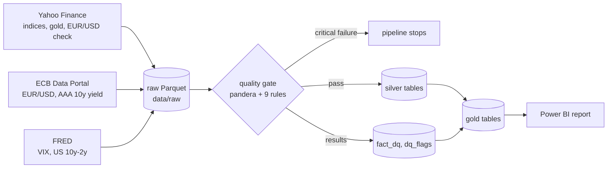

# Market Risk Monitor

Market risk monitoring of a fictional multi-asset trading book in euros (equities, gold, euro rates, USD).

The goal: a nightly Python pipeline that collects and checks market data, forecasts volatility, computes a 99% VaR and a 97.5% Expected Shortfall, and backtests them, with the results reported in Power BI.

**Status:** work in progress. Ingestion and the data quality gate are in place; this README grows as each part is built.

## Data lineage



Nine daily series from 2008, described with their units, calendars, licences and known issues in the [data dictionary](docs/data_dictionary.md). Critical rules (schema, duplicate keys, non-positive prices, yields out of range) stop the pipeline; warnings (missing sessions, stale values, moves above 15%, late data, Yahoo vs ECB EUR/USD gap above 2%) are stored and reported.

## Quick start

```bash
python3.12 -m venv .venv && .venv/bin/pip install -r requirements.txt
cp .env.example .env               # then set POSTGRES_PASSWORD and FRED_API_KEY
docker compose up -d               # PostgreSQL 16 on 127.0.0.1:5432

.venv/bin/python -m pipeline.ingest                       # download raw data
.venv/bin/python -m pipeline.quality --fail-on critical   # quality gate
.venv/bin/pytest                                           # tests
```

## License

MIT, see [LICENSE](LICENSE).

## Credits

Built with the help of [Claude Code](https://claude.com/claude-code).
