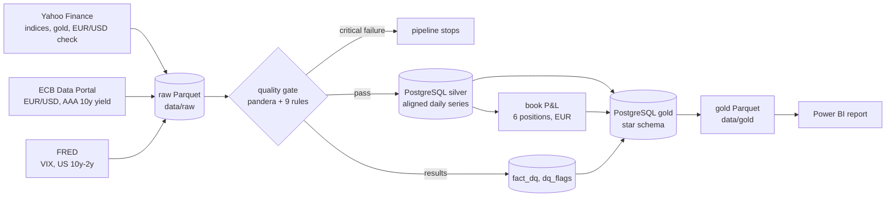

# Market Risk Monitor

Market risk monitoring of a fictional multi-asset trading book in euros (equities, gold, euro rates, USD).

The goal: a nightly Python pipeline that collects and checks market data, forecasts volatility, computes a 99% VaR and a 97.5% Expected Shortfall, and backtests them, with the results reported in Power BI.

**Status:** work in progress. Ingestion, the data quality gate, the silver/gold storage, the book P&L and a first Power BI report are in place; this README grows as each part is built.

## Data lineage



Nine daily series from 2008, described with their units, calendars, licences and known issues in the [data dictionary](docs/data_dictionary.md). Critical rules (schema, duplicate keys, non-positive prices, yields out of range) stop the pipeline; warnings (missing sessions, stale values, moves above 15%, late data, Yahoo vs ECB EUR/USD gap above 2%) are stored and reported.

Silver aligns every series on the days when Paris or New York trades, carrying the last value forward on a market holiday or a feed gap, with the reason recorded. Gold is a star schema (`fact_market`, `fact_dq` around `dim_date`, `dim_instrument` and reference dimensions) with a trading-day index for rolling windows; it is exported to Parquet for the report, with raw levels only where the source licence allows it.

## The book

A fictional 10 M€ book with constant notionals (daily rebalancing), valued in euros every trading day since January 2008:

| Position | Notional | Risk carried |
|---|---|---|
| CAC 40 | 2 M€ | French equities |
| Euro Stoxx 50 | 2 M€ | Euro area equities |
| S&P 500 | 2 M€ | US equities and USD |
| Gold | 1 M€ | Gold and USD |
| 10-year euro zero-coupon bond | 2 M€ | Euro rates (AAA curve, constant maturity) |
| USD cash | 1 M€ | USD/EUR |

USD positions are converted at the ECB reference rate. The P&L is hypothetical (fixed positions revalued with market moves). Over 2008-2026 the book's annualised P&L volatility is 1.11 M€, a third below the sum of the stand-alone positions; its worst day is 12 March 2020 (−687 k€, about ten daily standard deviations). Analysis in [`notebooks/01_book_pnl.ipynb`](notebooks/01_book_pnl.ipynb).

## Power BI report

Three pages on the gold Parquet tables, saved as a Power BI Project in [`powerbi/`](powerbi/): the semantic model in TMDL and the pages in PBIR, so every change to a measure or a visual is a reviewable diff. Report changes are listed in [CHANGELOG.md](CHANGELOG.md).

**Market.** Return, volatility, worst day and drawdown over the selected dates; indices rebased to 100 on a log scale, 22-day volatility and the euro AAA 10-year yield.


**Correlation.** Pairwise correlation of daily moves by period. Over the last 250 days, Euro Stoxx 50 returns and 10-year yield changes correlate at −0.47, against +0.20 since 2008: the book's bond position has recently moved with its equities instead of against them.


**Data quality.** Results of the latest quality run, flagged observations by rule and series, and how late each series is.


To open it, run the pipeline below, open `powerbi/MarketRiskMonitor.pbip` in Power BI Desktop, point the `DataFolder` parameter (Transform data > Edit parameters) to your `data/gold` folder and refresh.

## Quick start

```bash
python3.12 -m venv .venv && .venv/bin/pip install -r requirements.txt
cp .env.example .env               # then set POSTGRES_PASSWORD and FRED_API_KEY
docker compose up -d               # PostgreSQL 16 on 127.0.0.1:5432

.venv/bin/python -m pipeline.ingest                       # download raw data
.venv/bin/python -m pipeline.quality --fail-on critical   # quality gate
.venv/bin/python -m pipeline.transform                    # silver and gold tables in PostgreSQL
.venv/bin/python -m pipeline.book                         # daily P&L of the book
.venv/bin/python -m pipeline.publish                      # gold tables to data/gold/*.parquet
.venv/bin/pytest                                           # tests (database tests skip without PostgreSQL)
```

## License

MIT, see [LICENSE](LICENSE).

## Credits

Built with the help of [Claude Code](https://claude.com/claude-code).
