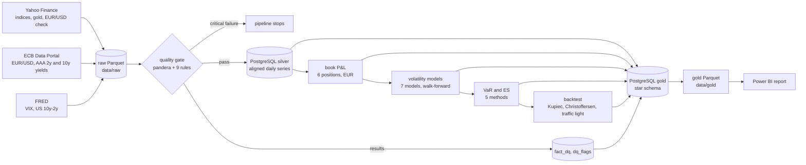

# Market Risk Monitor

Market risk monitoring of a fictional multi-asset trading book in euros (equities, gold, euro rates, USD).

The goal: a nightly Python pipeline that collects and checks market data, forecasts volatility, computes a 99% VaR and a 97.5% Expected Shortfall, and backtests them, with the results reported in Power BI.

**Status:** v1.0 (19 October 2026): data pipeline, volatility forecasts, VaR and Expected Shortfall with their backtest, and a six-page Power BI report. Scheduling and monitoring, trading costs, market regimes, anomaly detection and a public web app come next.

## Data lineage



Ten daily series from 2008, described with their units, calendars, licences and known issues in the [data dictionary](docs/data_dictionary.md). Critical rules (schema, duplicate keys, non-positive prices, yields out of range) stop the pipeline; warnings (missing sessions, stale values, moves above 15%, late data, Yahoo vs ECB EUR/USD gap above 2%) are stored and reported.

Silver aligns every series on the days when Paris or New York trades, carrying the last value forward on a market holiday or a feed gap, with the reason recorded. Gold is a star schema (`fact_market`, `fact_dq` around `dim_date`, `dim_instrument` and reference dimensions) with a trading-day index for rolling windows; it is exported to Parquet for the report, with raw levels only where the source licence allows it.

## The book

A fictional 10 M€ book with constant notionals (daily rebalancing), valued in euros every trading day since January 2008:

| Position | Notional | Risk carried |
|---|---|---|
| CAC 40 | 2 M€ | French equities |
| Euro Stoxx 50 | 2 M€ | Euro area equities |
| S&P 500 | 2 M€ | US equities and USD |
| Gold | 1 M€ | Gold and USD |
| 10-year euro zero-coupon bond | 2 M€ | Euro rates (AAA curve, constant maturity) |
| USD cash | 1 M€ | USD/EUR |

USD positions are converted at the ECB reference rate. The P&L is hypothetical (fixed positions revalued with market moves). Over 2008-2026 the book's annualised P&L volatility is 1.11 M€, a third below the sum of the stand-alone positions; its worst day is 12 March 2020 (−687 k€, about ten daily standard deviations). Analysis in [`notebooks/01_book_pnl.ipynb`](notebooks/01_book_pnl.ipynb).

## Volatility forecasting

Seven models forecast the variance of each position and of the book over the next five trading days ([`pipeline/vol_models.py`](pipeline/vol_models.py), analysis in [`notebooks/02_volatility.ipynb`](notebooks/02_volatility.ipynb)): EWMA, GARCH(1,1), GJR-GARCH(1,1), HAR, HAR on range-based variance (open, high, low and close), XGBoost and a GRU. They are trained on 2008-2017 and refitted every month from 2018 on an expanding window, with purged training rows, then scored with QLIKE and compared with HAR by Diebold-Mariano tests with a Newey-West variance over 2,269 out-of-sample days.

| Book, 2018-2026 | EWMA | GARCH | GJR | HAR | XGBoost | GRU |
|---|---|---|---|---|---|---|
| QLIKE (lower is better) | 0.453 | 0.417 | 0.399 | 0.427 | 0.440 | 0.402 |
| Diebold-Mariano p-value against HAR | 0.090 (worse) | 0.262 | 0.080 | | 0.524 (worse) | 0.153 |

GJR-GARCH is the champion volatility forecast for the VaR: lowest QLIKE on the book, significantly better than HAR on six of the seven series and the most accurate in the 2020 crash, though its gain over HAR on the book itself is not significant (p = 0.08). With the VIX among its inputs, XGBoost is the most accurate model on the three equity indices and significantly better than HAR there, but the least accurate on the book in 2020; the GRU is significantly better than HAR on no series. Machine learning adds accuracy where an extra input carries information, in line with Branco, Rubesam and Zevallos (2024).

Main references: Bollerslev (1986), Glosten, Jagannathan and Runkle (1993), Corsi (2009), Garman and Klass (1980), Yang and Zhang (2000), Patton (2011), Diebold and Mariano (1995), Hansen and Lunde (2005), Hansen, Lunde and Nason (2011), Christensen, Siggaard and Veliyev (2023), Branco, Rubesam and Zevallos (2024); full citations in the notebook.

## Value at Risk and Expected Shortfall

The 1-day VaR 99% and ES 97.5% of the book are computed every day from 2012 with five methods ([`pipeline/var.py`](pipeline/var.py), analysis in [`notebooks/03_var.ipynb`](notebooks/03_var.ipynb)): historical simulation on the last 250 P&Ls, normal parametric with EWMA, GARCH and GJR-GARCH 1-day forecasts, and filtered historical simulation (500 returns standardised by GJR-GARCH and rescaled to tomorrow's volatility). Each figure is stored with the day it covers.

In March 2020 the volatility-driven VaRs doubled by 25-28 February, before the worst losses of 9-16 March; historical simulation doubled only on 17 March and stayed at its peak until February 2021. On 12 March 2020, the book's worst day (a loss of 687 k€), the VaR was 220 k€ with historical simulation, 556 k€ with the GJR parametric method and 754 k€ with filtered historical simulation. The backtest below decides which one to use.

## Backtesting

Each day's VaR is compared with the book's actual P&L on the day it covers, over 3,823 days from 2012 ([`pipeline/backtest.py`](pipeline/backtest.py), analysis in [`notebooks/04_backtest.ipynb`](notebooks/04_backtest.ipynb)): exception counts against the 1% promised, Kupiec's proportion-of-failures test, Christoffersen's independence test and the Basel traffic light on 250 days.

| VaR 99%, 2012-2026 | Exceptions (38 expected) | Kupiec p | Christoffersen p | Worst zone |
|---|---|---|---|---|
| Filtered historical simulation | 38 | 0.970 | 0.382 | yellow |
| Parametric (GJR) | 54 | 0.016 | 0.213 | yellow |
| Historical simulation | 55 | 0.011 | < 0.001 | red |
| Parametric (GARCH) | 56 | 0.007 | 0.010 | red |
| Parametric (EWMA) | 74 | < 0.001 | 0.003 | red |

Filtered historical simulation is the recommended risk figure: the only method that passes every test, including 2020 (3 exceptions for 2.6 expected) and 2022 (3 for 2.6), with 93% of days in the green zone and none in the red. The normal parametric methods are exceeded too often even with the GJR forecast, consistent with the fat tails of the returns; historical simulation adds clustered exceptions to that.

## Power BI report

Six pages on the gold Parquet tables, saved as a Power BI Project in [`powerbi/`](powerbi/): the semantic model in TMDL (43 measures) and the pages in PBIR, so every change to a measure or a visual is a reviewable diff. Report changes are listed in [CHANGELOG.md](CHANGELOG.md); the full report is also in [`docs/report.pdf`](docs/report.pdf).

**Risk.** The latest VaR and ES of the book for the selected method (filtered historical simulation by default), the 250-day exception count and Basel traffic light, the daily P&L against the VaR with exception days in red, and the backtest of the five methods.


**Models.** Volatility forecasts against realised volatility for any series and model, the QLIKE of every model on every series, and Diebold-Mariano tests against HAR.


**Market.** Return, volatility, worst day and drawdown over the selected dates; indices rebased to 100 on a log scale, 22-day volatility and the euro AAA 2-year and 10-year yields.


**Correlation.** Pairwise correlation of daily moves by period. Over the last 250 days, Euro Stoxx 50 returns and 10-year yield changes correlate at −0.47, against +0.20 since 2008: the book's bond position has recently moved with its equities instead of against them.


**Data quality.** Results of the latest quality run, flagged observations by rule and series, and how late each series is. A **Read me** page gives the definitions, sources and refresh procedure.


To open it, download `MarketRiskMonitor.pbix` from the [v1.0 release](https://github.com/MedChahb/market_risk_monitor/releases/tag/v1.0) (data included), or open `powerbi/MarketRiskMonitor.pbip`. To refresh either, point the `DataFolder` parameter (Transform data > Edit parameters) to the repository's `data/gold` folder, which holds the published tables, and click Refresh.

## Quick start

```bash
python3.12 -m venv .venv && .venv/bin/pip install -r requirements.txt
cp .env.example .env               # then set POSTGRES_PASSWORD and FRED_API_KEY
docker compose up -d               # PostgreSQL 16 on 127.0.0.1:5432

.venv/bin/python -m pipeline.ingest                       # download raw data
.venv/bin/python -m pipeline.quality --fail-on critical   # quality gate
.venv/bin/python -m pipeline.transform                    # silver and gold tables in PostgreSQL
.venv/bin/python -m pipeline.book                         # daily P&L of the book
.venv/bin/python -m pipeline.vol_models                   # volatility forecasts (the GRU: about 30 min on a GPU, 70 on CPU)
.venv/bin/python -m pipeline.var                          # daily VaR and ES of the book
.venv/bin/python -m pipeline.backtest                     # exceptions, Kupiec, Christoffersen, traffic light
.venv/bin/python -m pipeline.publish                      # gold tables to data/gold/*.parquet
.venv/bin/pytest                                           # tests (database tests skip without PostgreSQL)
```

## License

MIT, see [LICENSE](LICENSE).

## Credits

Built with the help of [Claude Code](https://claude.com/claude-code).
