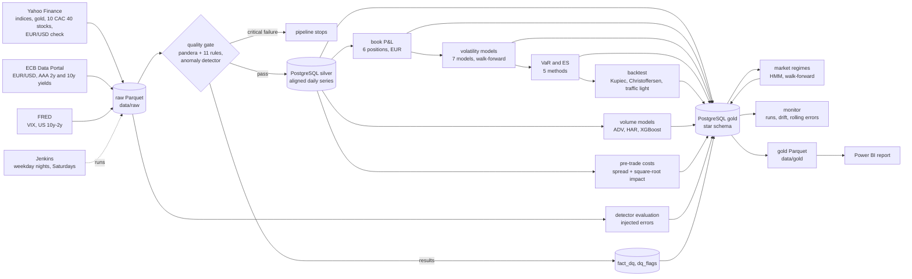
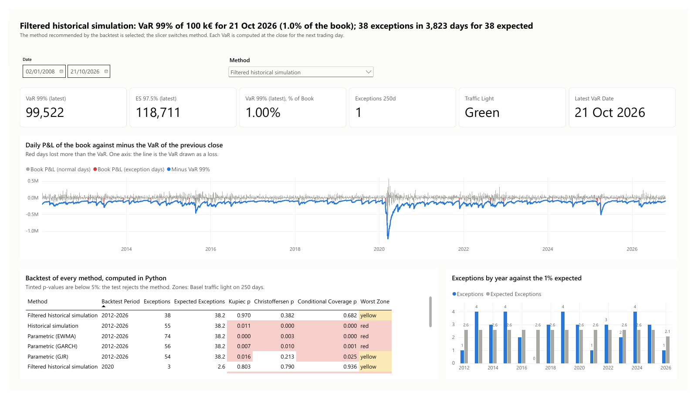
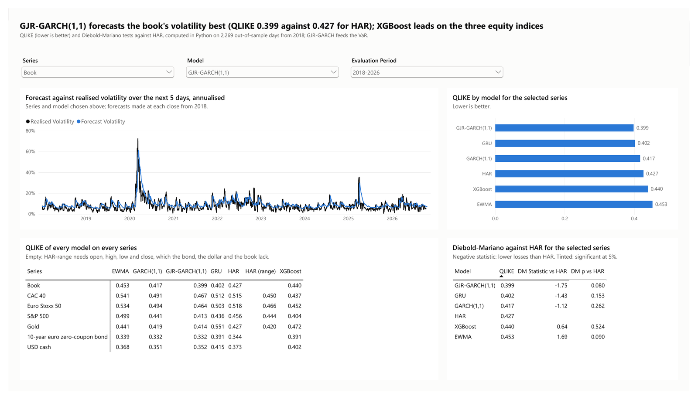
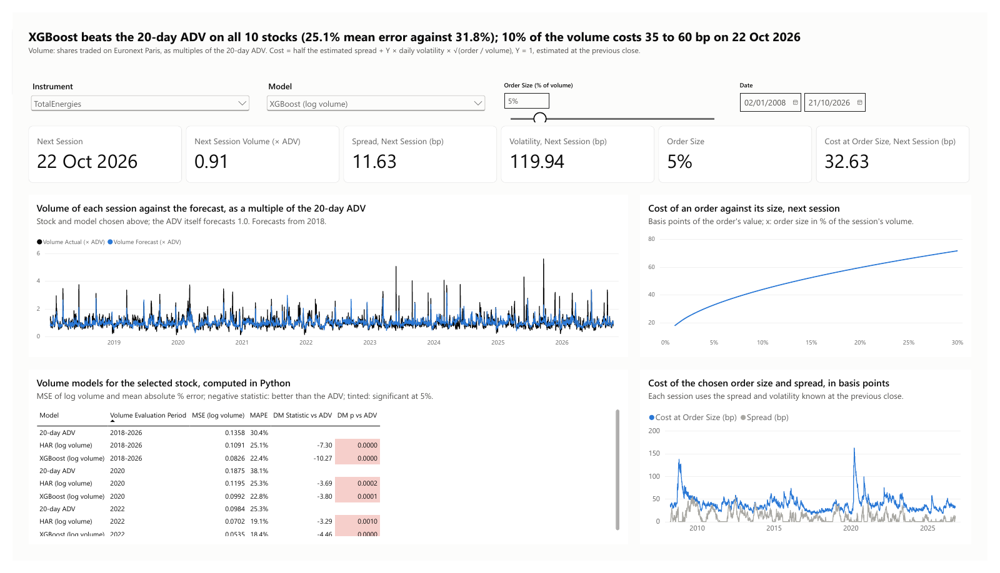
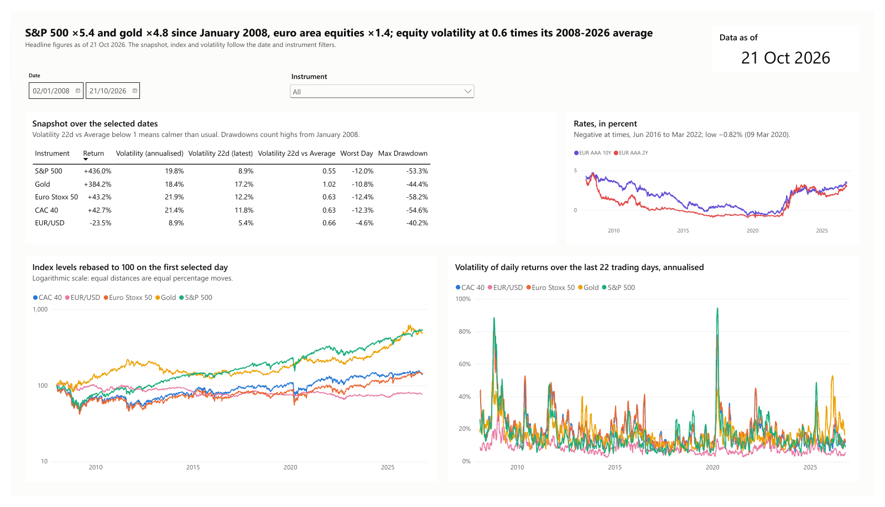
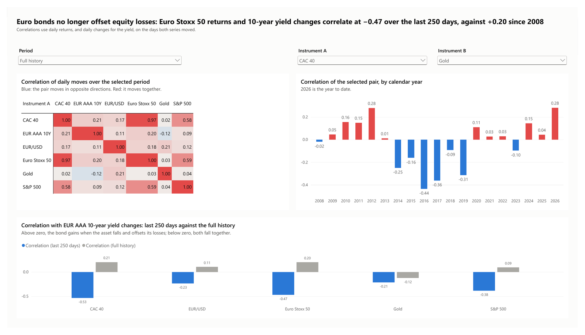
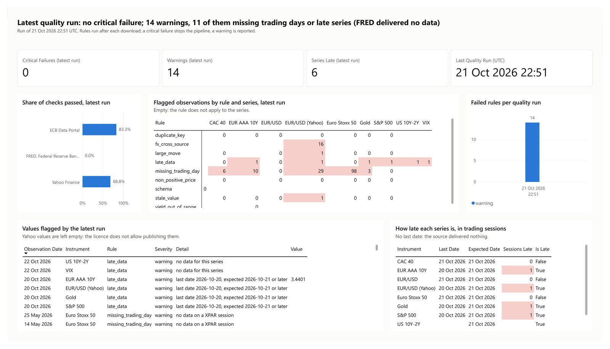
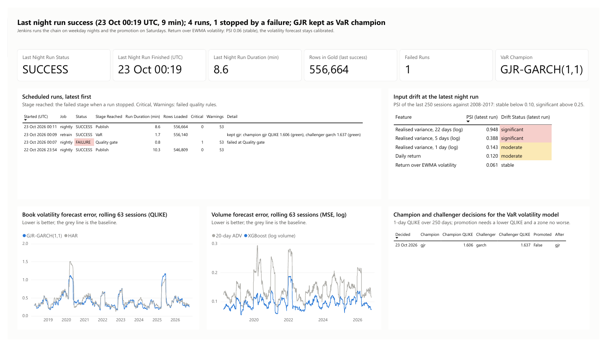

# Market Risk Monitor

[](https://github.com/MedChahb/market_risk_monitor/actions/workflows/ci.yml)

Market risk monitoring of a fictional multi-asset trading book in euros (equities, gold, euro rates, USD), and pre-trade volume and cost estimates for ten large French stocks.

Before each session a risk desk needs a risk figure it can trust, evidence that the figure holds, and an early warning when the data or the models drift. This project builds that chain on free data: a nightly Python pipeline that collects and checks market data, forecasts volatility, computes a 99% VaR and a 97.5% Expected Shortfall and backtests them, forecasts traded volumes and estimates the cost of an order, monitors its own runs and models, and reports the results in Power BI.

**Status:** v1.1 (23 October 2026). The v1.0 risk chain (data pipeline, volatility forecasts, VaR and Expected Shortfall with their backtest), plus volume forecasts and pre-trade costs for ten CAC 40 stocks, daily market regimes, an anomaly detector for market data, scheduled and monitored runs in Jenkins with an MLflow model registry, and an eight-page Power BI report. A public web app comes next.

## Key results

| Question | Finding |
|---|---|
| Which VaR can the desk rely on? | Filtered historical simulation: 38 exceptions for 38.2 expected over 3,824 days since 2012, passes Kupiec's and Christoffersen's tests, never in the red zone. The four other methods are rejected. |
| Which volatility forecast feeds it? | GJR-GARCH: the lowest forecast loss on the book over 2018-2026 (QLIKE 0.399 against 0.427 for HAR) and the most accurate in the 2020 crash. |
| Can volume be forecast better than the 20-day average? | Yes: XGBoost with calendar effects cuts the mean absolute error from 31.8% to 25.1% and beats the average on all ten stocks. |
| What does an order cost? | 35 to 60 bp for 10% of a session's volume on 22 October 2026, about three times more in March 2020. |
| Does the market regime matter? | Normal-distribution VaRs fail in calm markets (36 exceptions for 21.9 expected); filtered historical simulation stays close to 1%. |
| Can bad prices be caught? | 91.2% precision on injected errors: every frozen price, decimal shift and missing day, 78.5% of spikes, and none of the ten largest real moves flagged. |

## Data lineage



Twenty daily series from 2008, described with their units, calendars, licences and known issues in the [data dictionary](docs/data_dictionary.md). Critical rules (schema, duplicate keys, non-positive prices, yields out of range) stop the pipeline; warnings (missing sessions, stale values, moves above 15% for indices and 25% for stocks, late data, Yahoo vs ECB EUR/USD gap above 2%, zero volume, suspect prices from the anomaly detector) are stored and reported.

Silver aligns every series on the days when Paris or New York trades, carrying the last value forward on a market holiday or a feed gap, with the reason recorded; the stocks keep their own daily bars. Gold is a star schema (`fact_market`, `fact_dq` around `dim_date`, `dim_instrument` and reference dimensions) with a trading-day index for rolling windows; it is exported to Parquet for the report, with raw levels only where the source licence allows it.

## The book

A fictional 10 M€ book with constant notionals (daily rebalancing), valued in euros every trading day since January 2008:

| Position | Notional | Risk carried |
|---|---|---|
| CAC 40 | 2 M€ | French equities |
| Euro Stoxx 50 | 2 M€ | Euro area equities |
| S&P 500 | 2 M€ | US equities and USD |
| Gold | 1 M€ | Gold and USD |
| 10-year euro zero-coupon bond | 2 M€ | Euro rates (AAA curve, constant maturity) |
| USD cash | 1 M€ | USD/EUR |

USD positions are converted at the ECB reference rate. The P&L is hypothetical (fixed positions revalued with market moves). Over 2008-2026 the book's annualised P&L volatility is 1.11 M€, a third below the sum of the stand-alone positions; its worst day is 12 March 2020 (−687 k€, about ten daily standard deviations). Analysis in [`notebooks/01_book_pnl.ipynb`](notebooks/01_book_pnl.ipynb).

## Volatility forecasting

Seven models forecast the variance of each position and of the book over the next five trading days ([`pipeline/vol_models.py`](pipeline/vol_models.py), analysis in [`notebooks/02_volatility.ipynb`](notebooks/02_volatility.ipynb)): EWMA, GARCH(1,1), GJR-GARCH(1,1), HAR, HAR on range-based variance (open, high, low and close), XGBoost and a GRU. They are trained on 2008-2017 and refitted every month from 2018 on an expanding window, with purged training rows, then scored with QLIKE and compared with HAR by Diebold-Mariano tests with a Newey-West variance over 2,269 out-of-sample days.

| Book, 2018-2026 | EWMA | GARCH | GJR | HAR | XGBoost | GRU |
|---|---|---|---|---|---|---|
| QLIKE (lower is better) | 0.453 | 0.417 | 0.399 | 0.427 | 0.440 | 0.402 |
| Diebold-Mariano p-value against HAR | 0.090 (worse) | 0.262 | 0.080 | | 0.524 (worse) | 0.153 |

GJR-GARCH is the champion volatility forecast for the VaR: lowest QLIKE on the book, significantly better than HAR on six of the seven series and the most accurate in the 2020 crash, though its gain over HAR on the book itself is not significant (p = 0.08). With the VIX among its inputs, XGBoost is the most accurate model on the three equity indices and significantly better than HAR there, but the least accurate on the book in 2020; the GRU is significantly better than HAR on no series. Machine learning adds accuracy where an extra input carries information, in line with Branco, Rubesam and Zevallos (2024).

Main references: Bollerslev (1986), Glosten, Jagannathan and Runkle (1993), Corsi (2009), Garman and Klass (1980), Yang and Zhang (2000), Patton (2011), Diebold and Mariano (1995), Hansen and Lunde (2005), Hansen, Lunde and Nason (2011), Christensen, Siggaard and Veliyev (2023), Branco, Rubesam and Zevallos (2024); full citations in the notebook.

## Value at Risk and Expected Shortfall

The 1-day VaR 99% and ES 97.5% of the book are computed every day from 2012 with five methods ([`pipeline/var.py`](pipeline/var.py), analysis in [`notebooks/03_var.ipynb`](notebooks/03_var.ipynb)): historical simulation on the last 250 P&Ls, normal parametric with EWMA, GARCH and GJR-GARCH 1-day forecasts, and filtered historical simulation (500 returns standardised by GJR-GARCH and rescaled to tomorrow's volatility). Each figure is stored with the day it covers.

In March 2020 the volatility-driven VaRs doubled by 25-28 February, before the worst losses of 9-16 March; historical simulation doubled only on 17 March and stayed at its peak until February 2021. On 12 March 2020, the book's worst day (a loss of 687 k€), the VaR was 220 k€ with historical simulation, 556 k€ with the GJR parametric method and 754 k€ with filtered historical simulation. The backtest below decides which one to use.

## Backtesting

Each day's VaR is compared with the book's actual P&L on the day it covers, over 3,824 days from 2012 ([`pipeline/backtest.py`](pipeline/backtest.py), analysis in [`notebooks/04_backtest.ipynb`](notebooks/04_backtest.ipynb)): exception counts against the 1% promised, Kupiec's proportion-of-failures test, Christoffersen's independence test and the Basel traffic light on 250 days.

| VaR 99%, 2012-2026 | Exceptions (38 expected) | Kupiec p | Christoffersen p | Worst zone |
|---|---|---|---|---|
| Filtered historical simulation | 38 | 0.970 | 0.382 | yellow |
| Parametric (GJR) | 54 | 0.016 | 0.213 | yellow |
| Historical simulation | 55 | 0.011 | < 0.001 | red |
| Parametric (GARCH) | 56 | 0.007 | 0.010 | red |
| Parametric (EWMA) | 74 | < 0.001 | 0.003 | red |

Filtered historical simulation is the recommended risk figure: the only method that passes every test, including 2020 (3 exceptions for 2.6 expected) and 2022 (3 for 2.6), with 93% of days in the green zone and none in the red. The normal parametric methods are exceeded too often even with the GJR forecast, consistent with the fat tails of the returns; historical simulation adds clustered exceptions to that.

## Volumes and trading costs

For ten large CAC 40 stocks (the ten largest weights on 31 March 2017, fixed before the test period to avoid picking past winners), the pipeline forecasts the next session's traded volume and estimates the cost of an order ([`pipeline/volume_models.py`](pipeline/volume_models.py), [`pipeline/costs.py`](pipeline/costs.py), analysis in [`notebooks/05_execution.ipynb`](notebooks/05_execution.ipynb)). Volume is the number of shares traded on Euronext Paris, which Yahoo reports exactly as Euronext publishes it.

| Next-session volume, 2018-2026, mean of 10 stocks | 20-day ADV | HAR (log volume) | XGBoost (log volume) |
|---|---|---|---|
| Mean squared error of log volume | 0.145 | 0.115 | 0.095 |
| Mean absolute percentage error | 31.8% | 26.9% | 25.1% |
| Stocks significantly better than the ADV (Diebold-Mariano, 5%) | | 10 | 10 |

Both models beat the desks' 20-day ADV on every stock, also in 2020 and 2022, and XGBoost beats HAR on all ten: the calendar drives volume (quarterly expiry days trade 2.35 times the ADV, the session before a holiday 0.54 times), which XGBoost sees through its calendar flags.

The pre-trade cost is half the bid-ask spread plus the square-root market impact, `Y × daily volatility × √(order / volume)` with Y = 1 (Tóth et al., 2011; Tóth, Eisler and Bouchaud, 2016). On 22 October 2026 an order of 10% of the session's volume costs 35 to 60 bp depending on the stock; the same order in TotalEnergies cost about three times its median in March 2020. The spread is estimated from daily highs and lows (Corwin and Schultz, 2012); for stocks this liquid those estimates are dominated by noise, so the pipeline averages the signed estimates over 63 sessions instead of clipping them at zero, which would inflate the spread to 37-52 bp.

**Limits.** Volume covers Euronext Paris only, not the other venues where these shares trade; spreads are estimated, not quoted; Y comes from published studies, not from the desk's own executions, which post-trade TCA would use to calibrate it.

## Market regimes

Each day is labelled calm, normal or stress by a three-state Gaussian hidden Markov model on equity volatility, the 22-day equity return, the 63-day correlation between the equity indices and the VIX ([`pipeline/regimes.py`](pipeline/regimes.py), analysis in [`notebooks/06_regimes.ipynb`](notebooks/06_regimes.ipynb)). A fit on the whole history describes it; a second HMM, refitted every January on past data and filtered forward, gives the regime known at each close and is the one used to analyse the models.

The regimes match known episodes (78% of 2008 in stress, the 2020 crash from 27 February, 73% of 2022 in the walk-forward fit) and last 41 to 81 days on average, against 10 to 17 for a Gaussian mixture that ignores persistence. EM starts from k-means and a persistent transition matrix: random starts gave different labellings, and the best of ten changed when one day of data was added. By the regime known when each VaR was computed:

| VaR 99%, 2012-2026, exceptions / expected | Calm | Normal | Stress |
|---|---|---|---|
| Filtered historical simulation | 28 / 21.9 | 7 / 7.5 | 3 / 8.8 |
| Historical simulation | 33 / 21.9 | 7 / 7.5 | 15 / 8.8 |
| Parametric (GJR) | 36 / 21.9 | 7 / 7.5 | 11 / 8.8 |

The normal parametric VaR fails in calm markets (Kupiec p = 0.006): a normal distribution leaves no room for a shock out of a quiet market. Historical simulation is exceeded most in stress (18 times for 5.1 expected with hindsight regimes, p < 0.001; 15 for 8.8 walk-forward, p = 0.057). Filtered historical simulation is close to 1% in calm and normal regimes and conservative in stress (p = 0.023). GJR-GARCH has the lowest volatility forecast loss on the book in stress. The walk-forward stress state is less distinct than the full-history one: it also holds long spells of low equity correlation in 2021 and 2024. The yield-curve slope was left out of the features: it moves too slowly and turned a regime into the steep-curve years of the early 2010s.

## Market data anomaly detector

A wrong price propagates into the P&L, the VaR and every model, so suspect prices are flagged at ingestion ([`pipeline/anomalies.py`](pipeline/anomalies.py), analysis in [`notebooks/07_anomalies.ipynb`](notebooks/07_anomalies.ipynb)). A daily move is suspect when it is extreme for its series (a robust z-score against the previous 63 returns, from the median and MAD) and either reverses the next day while the other assets stay quiet (a bad tick), or is larger than any real move since 2008 (a level shift, such as an unadjusted split). The quality gate reports these days as a warning.

Market data has no labels, so the detector is measured on 200 errors of each type injected into the real closes of the fourteen Yahoo price series with a fixed seed ([`pipeline/anomaly_evaluation.py`](pipeline/anomaly_evaluation.py)):

| Errors caught (share of 200) | Spike | Frozen | Decimal ×10 | Split | Missing days | Roll jump | Precision |
|---|---|---|---|---|---|---|---|
| Rules (stale values, missing sessions) | 0% | 100% | 0% | 0% | 100% | 0% | 86.0% |
| Robust z-score | 78.5% | 0.5% | 100% | 95.5% | 0.5% | 0% | 99.2% |
| Isolation Forest, 1% of days flagged | 86.5% | 3.5% | 100% | 85% | 2.5% | 10.5% | 63.2% |
| **Production: rules and robust z-score** | **78.5%** | **100%** | **100%** | **95.5%** | **100%** | **0%** | **91.2%** |

The production detector flags none of the ten largest real moves and five days in eighteen years of real data, including an Air Liquide close on a quarterly expiry Friday that reversed the next day. The Isolation Forest is less precise for the same recall and flags genuine extreme days, so it is kept as a benchmark. Roll jumps of 2% to 6% look like ordinary moves and need the futures roll calendar or a second source.

## Scheduling and monitoring

The chain runs in Jenkins every weekday at 23:00 Paris time, after the US close ([`Jenkinsfile`](Jenkinsfile)): lint, tests, ingestion, quality gate, transform, P&L, volatility models, VaR and backtest, volumes and costs, regimes, the anomaly detector's evaluation, publish. A critical quality failure stops the run before the silver tables, so bad data never reaches the report. The GRU is left out of the scheduled runs; it is rerun by hand. Jenkins runs in Docker next to PostgreSQL, with Python 3.12 and the libraries installed in its image; jobs, credentials and the admin user come from configuration as code ([`jenkins/`](jenkins/)), and secrets reach it as Docker secrets from `.env`. GitHub Actions lints and tests every push ([`.github/workflows/ci.yml`](.github/workflows/ci.yml)). It is a scheduled pipeline on one machine, the same design a bank runs on its servers, and it runs when the machine is on.

Every Saturday a champion and challenger job ([`jenkins/Jenkinsfile.retrain`](jenkins/Jenkinsfile.retrain), [`pipeline/promotion.py`](pipeline/promotion.py)) scores the EWMA, GARCH and GJR-GARCH 1-day forecasts on the last 250 days. A challenger replaces the champion behind the parametric VaR only if its QLIKE is lower and the Basel zone of its VaR is no worse; the champion is an alias in the MLflow model registry, which the VaR stage reads. The first run kept GJR-GARCH (QLIKE 1.606 against 1.637 for GARCH, both green).

After every run, [`pipeline/monitor.py`](pipeline/monitor.py) records it in `fact_runs` (status, last stage reached, rows in gold, failed quality rules, promotion decision), the drift of the book's inputs (PSI over the last 250 sessions against 2008-2017) and the rolling errors of the volatility and volume models against their baselines. A duplicate price inserted by hand made the quality gate fail the run, every later stage was skipped, and the run appears as failed in `fact_runs`. The Production page of the report shows these tables, and the [runbook](docs/runbook.md) says what to do when a run fails.

## Power BI report

Eight pages on the gold Parquet tables, saved as a Power BI Project in [`powerbi/`](powerbi/): the semantic model in TMDL (72 measures, each with a description, listed in the [measure dictionary](docs/measures.md) generated from the TMDL files) and the pages in PBIR, so every change to a measure or a visual is a reviewable diff. Report changes are listed in [CHANGELOG.md](CHANGELOG.md); the full report is also in [`docs/report.pdf`](docs/report.pdf).

**Risk.** The latest VaR and ES of the book for the selected method (filtered historical simulation by default), the 250-day exception count and Basel traffic light, the daily P&L against the VaR with exception days in red, and the backtest of the five methods.



**Models.** Volatility forecasts against realised volatility for any series and model, the QLIKE of every model on every series and by market regime, and Diebold-Mariano tests against HAR.



**Execution.** For the chosen stock: the next session's volume forecast, spread and volatility, the cost of an order whose size is set with a slider, the cost curve against order size, the forecast against actual volume and the volume models' tests against the ADV.



**Market.** Return, volatility, worst day and drawdown over the selected dates; indices rebased to 100 on a log scale, 22-day volatility, the euro AAA 2-year and 10-year yields, and the probability of each market regime at each close.



**Correlation.** Pairwise correlation of daily moves by period. Over the last 250 days, Euro Stoxx 50 returns and 10-year yield changes correlate at −0.47, against +0.20 since 2008: the book's bond position has recently moved with its equities instead of against them.



**Data quality.** Results of the latest quality run, flagged observations by rule and series, how late each series is, and the anomaly detector's precision and recall on injected errors.



**Production.** The latest night run (status, end time, duration, rows in gold), every scheduled run with the stage it reached and its failed quality rules, the input drift measured at the latest run, the rolling errors of the volatility and volume models against their baselines, and the champion decisions. A **Read me** page gives the definitions, sources and refresh procedure.



To open it, download `MarketRiskMonitor.pbix` from the [v1.1 release](https://github.com/MedChahb/market_risk_monitor/releases/tag/v1.1) (data included), or open `powerbi/MarketRiskMonitor.pbip`. To refresh either, point the `DataFolder` parameter (Transform data > Edit parameters) to the repository's `data/gold` folder, which holds the published tables, and click Refresh.

## Limits

- **A fictional, static book.** Constant notionals give a hypothetical P&L, without fees, carry or intraday trading; a desk would also backtest on its actual P&L.
- **Free data.** One source per series (Yahoo Finance, the ECB, FRED). Yahoo prices are used but not redistributed: the published tables hold returns and derived figures for those series.
- **A 1-day horizon.** The VaR covers one day at 99%; there is no 10-day or stressed VaR, and the Expected Shortfall is reported but not backtested on its own. With 38 expected exceptions in fourteen years, the tests have limited power to separate close methods.
- **Volumes and costs.** Euronext Paris volume only; spreads estimated from daily prices, not quoted; the impact coefficient comes from published studies, not from executions.
- **Regimes.** Three states imposed; the walk-forward stress state is less distinct than the full-history one.
- **One machine.** The runs are scheduled on a local machine and run when it is on, without failover.

## Documentation

| Document | Content |
|---|---|
| [Data dictionary](docs/data_dictionary.md) | Every series and table: units, calendars, licences, known issues |
| [Model cards](docs/model_cards/README.md) | Purpose, data, validation, results, limits and monitoring of the six models in production |
| [Measure dictionary](docs/measures.md) | The 72 DAX measures of the report, generated from the TMDL files |
| [Runbook](docs/runbook.md) | The scheduled jobs, the morning check, and what to do when a run fails |
| [Note de restitution](docs/note_de_restitution.md) | One-page summary of the book's risk for a trader or a risk manager, in French |
| [Changelog](CHANGELOG.md) | Changes to the Power BI report, by release |
| [Report](docs/report.pdf) | Every page of the Power BI report, as a PDF |

## Quick start

```bash
python3.12 -m venv .venv && .venv/bin/pip install -r requirements.txt
cp .env.example .env               # then set POSTGRES_PASSWORD and FRED_API_KEY
docker compose up -d               # PostgreSQL 16 on 127.0.0.1:5432

.venv/bin/python -m pipeline.ingest                       # download raw data
.venv/bin/python -m pipeline.quality --fail-on critical   # quality gate
.venv/bin/python -m pipeline.transform                    # silver and gold tables in PostgreSQL
.venv/bin/python -m pipeline.book                         # daily P&L of the book
.venv/bin/python -m pipeline.vol_models                   # volatility forecasts (the GRU: about 30 min on a GPU, 70 on CPU)
.venv/bin/python -m pipeline.var                          # daily VaR and ES of the book
.venv/bin/python -m pipeline.backtest                     # exceptions, Kupiec, Christoffersen, traffic light
.venv/bin/python -m pipeline.volume_models                # next-session volume forecasts of the ten stocks
.venv/bin/python -m pipeline.costs                        # spreads and pre-trade costs
.venv/bin/python -m pipeline.regimes                      # market regimes, exceptions and forecast errors by regime
.venv/bin/python -m pipeline.anomaly_evaluation           # anomaly detector measured on injected errors
.venv/bin/python -m pipeline.publish                      # gold tables to data/gold/*.parquet
.venv/bin/pytest                                           # tests (database tests skip without PostgreSQL)

docker compose up -d --build jenkins                       # Jenkins on http://127.0.0.1:8080 (admin, JENKINS_ADMIN_PASSWORD)
```

## License

MIT, see [LICENSE](LICENSE).

## Credits

Built with the help of [Claude Code](https://claude.com/claude-code).
